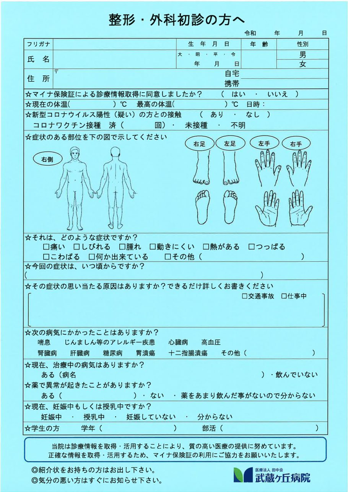
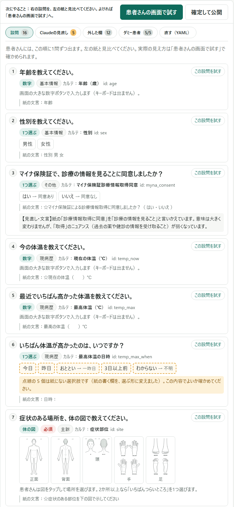
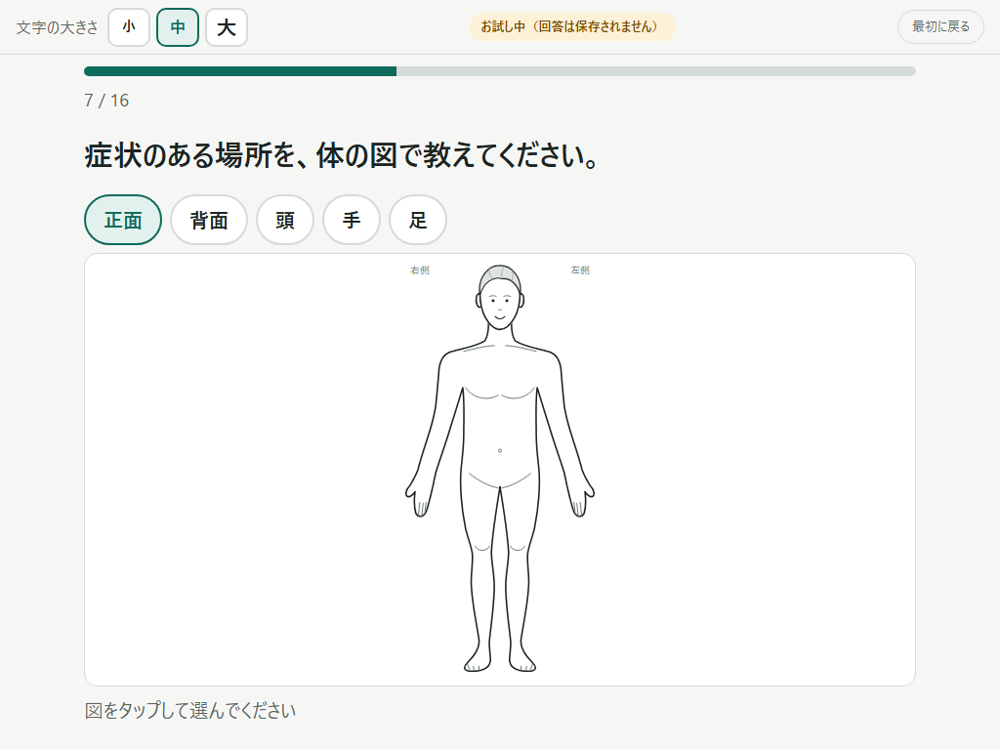
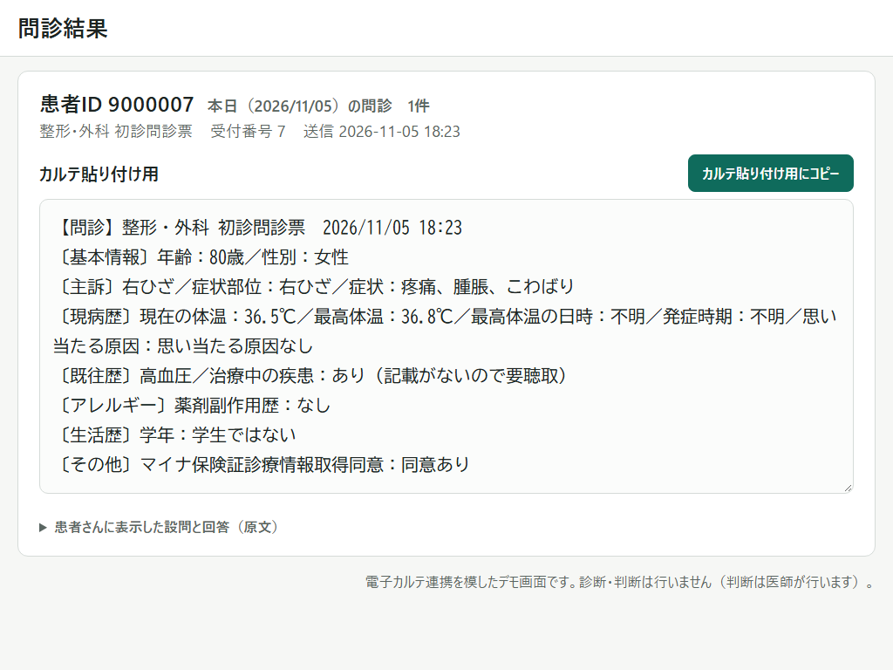
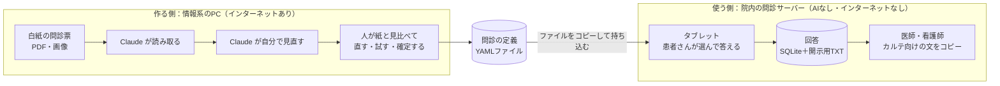
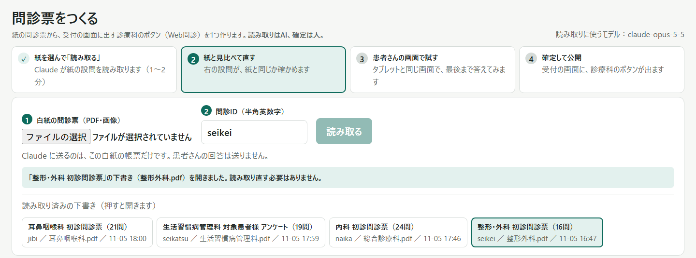
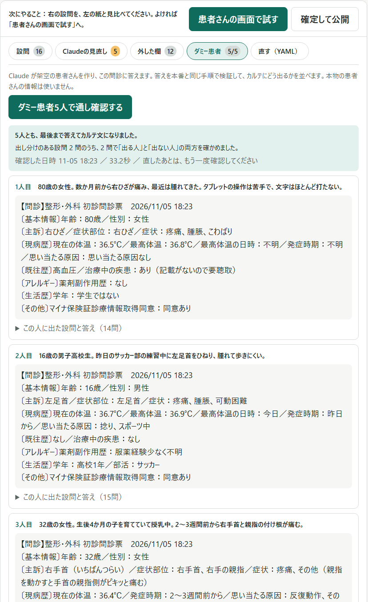
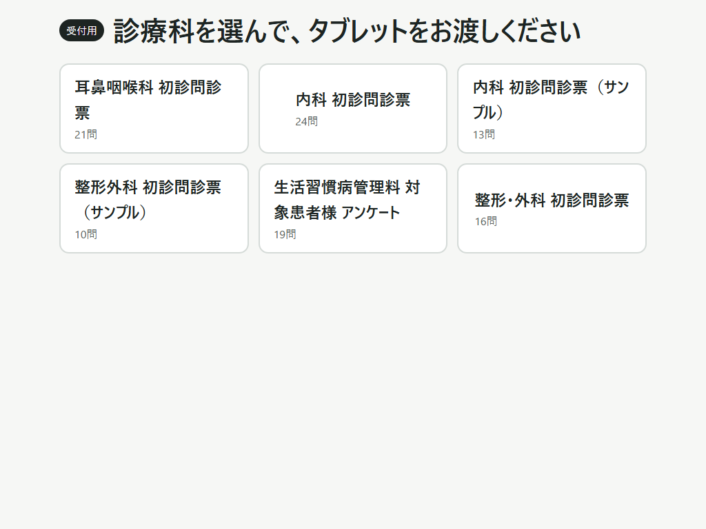
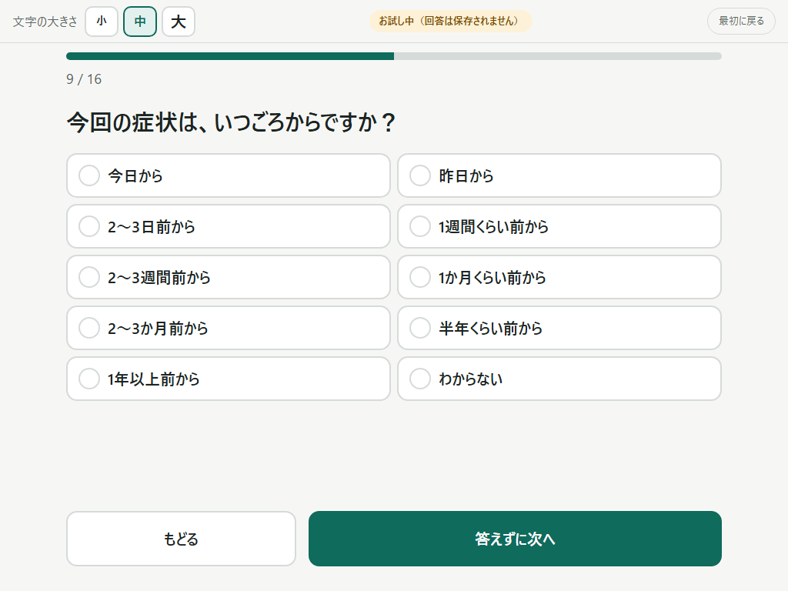
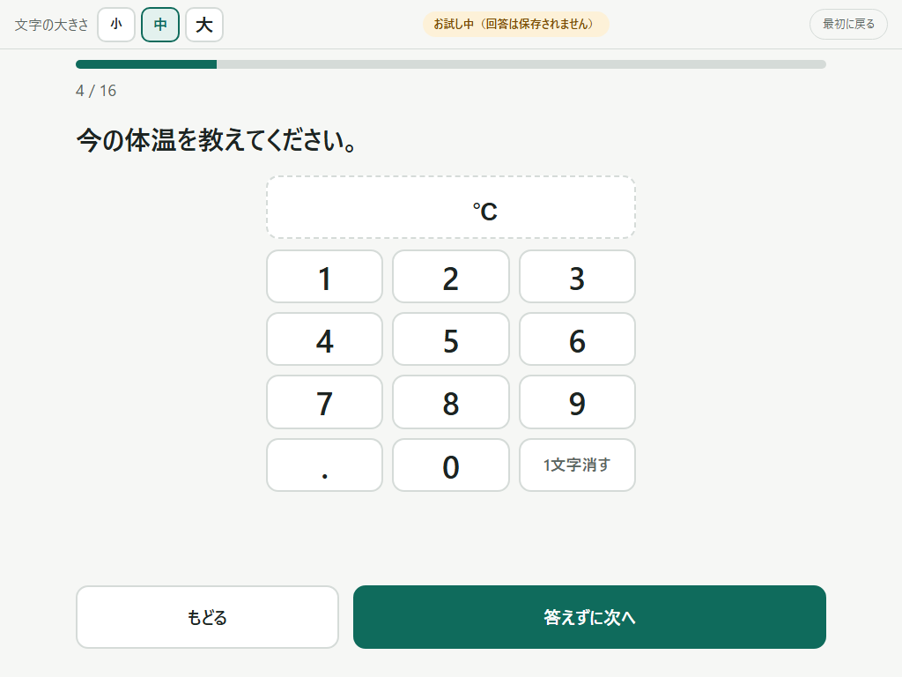

# トルモン（撮るだけWeb問診）

紙の問診票を撮る（スキャンする）だけで、その病院の紙と**同じ設問**の Web問診ができます。
患者さんはタブレットで選ぶだけ。回答はカルテ向けの文章に整えられ、医師・看護師がコピーして貼り付けます。

**読み取りはAI、確定は人、判断は医師。**

AI（Claude）を使うのは、問診票を**作るときだけ**です。患者さんが答えるとき、医師が見るときには、AIもインターネットも使いません。

Built with Claude: Japan 2026 提出作品（開発期間：2026年11月2日〜8日）

| 紙の問診票 | Claude が作った設問（人が確かめる） |
|---|---|
|  |  |

| 患者さんはタブレットで選ぶだけ | 医師・看護師はコピーして貼るだけ |
|---|---|
|  |  |

---

## なぜ作ったか

作者は病院の情報システム担当です。現場で感じていることが、出発点になっています。

- 回答に応じて設問が増えていく問診は、高齢の患者さんには難しく、「紙をください」と言われます。
- AIがまとめた長い文章は、忙しい診察の中では読まれず、結局は紙の問診票と二度手間になります。
- 一方で、紙の問診票は長年その病院で磨かれてきたものです。聞くべきことは、もう紙に書いてあります。

そこでトルモンは、「紙と同じ設問を、紙より楽に答えられる」ことだけに絞りました。

- **設問は増やさない。** 出し分けるのは、紙に書いてある条件と、病院が決めた条件だけです。
- **患者さんに文字を書かせない。** 紙の「（　　）」という書く欄は、Claude が問診を作るときに、選ぶ形へ変えておきます。
- **診断しない。** 病名の推定、受診の判断、治療や薬の提案は、一切しません。

（上の「現場で感じていること」は測定した数字ではなく、現場の実感です。）

## 仕組み



- **作る側**（`creator/`）だけが Claude を呼びます。送るのは、白紙の問診票と、そこから作った設問の定義だけです。
- **使う側**（`app/`・`web/`）には、AIのコードが入っていません。設定の `creator.enabled` を false にすると、作る側は読み込まれもしません。
- 2つをつなぐのは、人が確定した YAML ファイル1つです。
- ハッカソンでは1台のPCの中で両方を動かしていますが、病院ではこの2つを別のPC・別のネットワークに置く前提で作っています。

## 画面

### 1. 作る画面（情報システム担当が使う）

紙を選んで「読み取る」を押すと、1〜2分で設問の下書きができます。画面の上に手順が出て、いまやることに色がつきます。



- **設問**：患者さん向けの文、カルテ向けの項目名、選択肢、出る条件、もとになった紙の文言を並べます。
  Claude が足した選択肢（紙では書く欄だったもの）には点線の印が付き、人が確かめます。
- **Claude の見直し**：Claude が自分の読み取りを、もう一度紙と突き合わせて出した指摘です。
- **外した欄**：病院のルールで設問にしなかった欄と、その理由です。
- **患者さんの画面で試す**：公開する前に、タブレットと同じ画面で最後まで答えられます（回答は保存されません）。
- **ダミー患者**：Claude が架空の患者さんを5人作って問診に答え、アプリがその回答を検証します（下の写真）。



### 2. 受付と患者さんの画面（タブレット）

受付は診療科を選んで、タブレットを渡すだけです。



患者さんは1問ずつ、選んで答えます。数字は画面の大きな数字ボタンで入れます（キーボードは出ません）。

| 選ぶ | 数字 |
|---|---|
|  |  |

- 体の図は、紙と同じ構図（正面・背面・頭・手・足）をタップします。2か所以上選んだときは「いちばんつらいところ」を1つ選びます。
- 記入欄は書かなくても進めます。書かなかったときは、カルテに「記載がないので要聴取」と出ます。
- 文字の大きさは小・中・大。操作がないまま時間がたつと、次の人に前の回答が見えないよう、最初の画面に戻ります。
- 送信すると受付番号だけが出ます。受付で、その番号に患者IDを結びます（大きな数字で確認してから登録）。

### 3. 医師・看護師の画面

電子カルテの患者画面から開く想定です（`/karte?pcode=患者ID`）。その患者さんの当日の問診が、カルテに貼り付ける文で出ます。

```
【問診】整形・外科 初診問診票　2026/11/05 18:23
〔基本情報〕年齢：80歳／性別：女性
〔主訴〕右ひざ／症状部位：右ひざ／症状：疼痛、腫脹、こわばり
〔現病歴〕現在の体温：36.5℃／最高体温：36.8℃／最高体温の日時：不明／発症時期：不明／思い当たる原因：思い当たる原因なし
〔既往歴〕高血圧／治療中の疾患：あり（記載がないので要聴取）
〔アレルギー〕薬剤副作用歴：なし
〔生活歴〕学年：学生ではない
〔その他〕マイナ保険証診療情報取得同意：同意あり
```

（これは Claude が作った架空の患者さんの回答です。）

## Claude の使いどころ

| | 何をするか | どこ |
|---|---|---|
| 1. 読み取り | 白紙の問診票（PDF・画像）から、設問・選択肢・出る条件・患者さん向けの文・カルテ向けの項目名を作る。紙の書く欄は、選ぶ形に変える | `creator/reader.py` |
| 2. 見直し | できた定義を、もう一度紙と1欄ずつ突き合わせて、抜け・余計・言いかえすぎを報告する | `creator/reader.py` |
| 3. ダミー患者 | 出し分けがひととおり通るように架空の患者さんを作り、問診に答える。回答の検証とカルテ文づくりは、AIを使わずアプリが行う | `creator/dummy.py` |
| 4. 開発 | 設計・実装・テスト・この README まで、Claude Code と一緒に作りました | `PROGRESS.md` |

- 病院ごとの決まり（聞かない欄、決まった選択肢、言い方）は、ふつうの日本語で `creator/hospital_rules.md` に書きます。書き換えれば、ほかの病院の問診票にも使えます。
- 結果は JSON スキーマで受け取り、アプリが決めた書き方の YAML に直します。壊れた定義は、読み込むときにはじきます。
- Claude API は、Python の標準ライブラリ（urllib）だけで呼んでいます。モデルは Claude Opus 5.5 です。

### 実際の問診票で試した結果

作者の勤務先の病院で使っている白紙の問診票4枚で試しました（公開の了承を得ています）。

| 問診票 | 設問 | Claude が足した選択肢 | 読み取り＋見直し | ダミー患者5人 |
|---|---|---|---|---|
| 整形・外科 | 16 | 50 | 92秒 | 5人とも受け取り・出し分け2問を確認 |
| 内科 | 24 | 43 | 134秒 | 5人とも受け取り・出し分け8問を確認 |
| 耳鼻咽喉科 | 21 | 36 | 114秒 | 5人とも受け取り・出し分け9問を確認 |
| 生活習慣病管理料 | 19 | 0 | 66秒 | 5人とも受け取り・出し分け1問を確認 |

- 4枚とも、形式の問題はありませんでした。読み取ったあとに人が直したのは、文言・選択肢・出る条件で、1枚につき0〜3か所です。
- 「出し分けを確認」は、その設問が出る人と出ない人の両方がいた、という意味です。5人では、すべての選択肢を1つずつは試せません。
- 読み取りは毎回少し変わります。だから、人が紙と見比べて確定する手順を必ず通します。
- 費用は、開発中の実績で、1枚あたり読み取りと見直しを合わせて約0.2ドルでした（目安）。

## プライバシーと安全の設計

- **患者さんの回答は、AIにも院外にも出ません。** Claude に送るのは白紙の問診票と設問の定義だけです。
- 使う側のサーバーは、AIのコードを読み込まず、インターネットにもつなぎません。
- 氏名・生年月日・住所・電話番号は聞きません。回答は患者IDで電子カルテとひも付けます。
- 電子カルテのデータベースには書き込みません。医師・看護師が文をコピーして貼り付けます。
- 回答は消しません。患者IDが結ばれなかった回答も残します（開示に備えるため）。開示用に、患者さんへ表示した設問と回答の原文を TXT でも残します。
- 送信後のタブレットには、受付番号しか出しません。
- このリポジトリには、本物の患者さんの情報は入っていません。入っているのは、Claude が作った架空の患者さんだけです。

## 動かし方

必要なものは **Python 3.13** だけです（外部のライブラリは使いません）。Windows で動作を確かめています。

```bash
git clone https://github.com/masakazu-satogawa/tolmon.git
```

```bash
cd tolmon
```

```bash
python -X utf8 run.py
```

Windows では `start.bat` をダブルクリックしても起動します。止めるときは Ctrl+C です。

| 画面 | URL |
|---|---|
| 受付・患者さん | http://localhost:8080/ |
| 受付待ちの一覧 | http://localhost:8080/reception |
| 医師・看護師 | http://localhost:8080/karte?pcode=9000001 |
| 問診の一覧 | http://localhost:8080/doctor |
| 作る画面 | http://localhost:8080/admin |

### APIキーがなくても試せること

問診票6枚（実際の4枚と、架空の見本2枚）が `definitions/` に入っているので、受付 → 患者さん → 医師の流れは、そのまま試せます。

架空の患者さん8人の回答を入れるには、次を実行します（Windows では `demo_reset.bat` でも同じです）。

```bash
python -X utf8 tools/demo.py reset --seed
```

`reset` は、それまでの回答を `data/backup/` へ移して空にします（消しません）。設定の `demo.enabled` が true のときだけ動きます。

### 作る画面を使うとき（APIキーが必要）

`tolmon` フォルダに `.env` というファイルを作り、Claude の APIキーを1行書きます。

```
ANTHROPIC_API_KEY=sk-ant-…
```

そのあと http://localhost:8080/admin を開き、問診票の PDF か画像を選んで「読み取る」を押します。

### テスト

```bash
python -X utf8 -m unittest discover -s tests
```

35件あります。AIを呼ばない部分（YAML、定義の検証、回答の検証、カルテ文、出し分け、保存、デモ用の道具）を確かめています。

## フォルダの中身

| | 役割 |
|---|---|
| `app/` | 使う側のサーバー。YAML の読み書き、定義の検証、回答の検証と保存、カルテ文づくり |
| `web/` | 画面（素の HTML・CSS・JavaScript。ビルドなし） |
| `creator/` | 作る側。Claude API の呼び出し、読み取り、見直し、ダミー患者、病院のルール |
| `definitions/` | 確定した問診の定義（1ファイル＝1問診票） |
| `samples/` | 架空の患者さんの回答（デモ用） |
| `tools/` | 体の図を作る、デモ用の準備、画面写真を撮る（画面写真の道具だけ、Pillow と PyMuPDF があれば使います） |
| `tests/` | テスト |
| `config.example.yaml` | 設定の見本 |
| `PROGRESS.md` | 日ごとの開発ログ |

## 病院で使うまでに、まだやること

ハッカソンの期間では、次のことはできていません。隠さずに書いておきます。

- **実機での確認**：iPad（第7世代から）と Android タブレットで動くように作っていますが、実機ではまだ確かめていません。
- **医師・看護師による中身の確認**：Claude が足した選択肢と、体の図の区切りは、作者が確かめた段階です。本番の前に、医師・看護師の確認が要ります。
- **院内ネットワークでの確認**：カルテ向けの文のコピーは、院内の http でも動くよう3通りの方法を用意していますが、院内の端末では試していません。
- **HTTPS と患者カードのバーコード読み取り**：本番では、タブレットのカメラで患者カードを読んで患者IDを入れる計画です。まだ作っていません。
- **電子カルテからの呼び出し**：`/karte?pcode=患者ID` を電子カルテ側のボタンから開く設定は、これからです。

## 免責

- これはハッカソンのために作った試作です。医療機器ではありません。
- 診断、病名の推定、受診の判断、治療や薬の提案はしません。判断は医師が行います。
- 実際の診療で使うときは、各医療機関の責任で、内容と安全性を確かめてください。

## ライセンス

MIT License（[LICENSE](LICENSE)）
